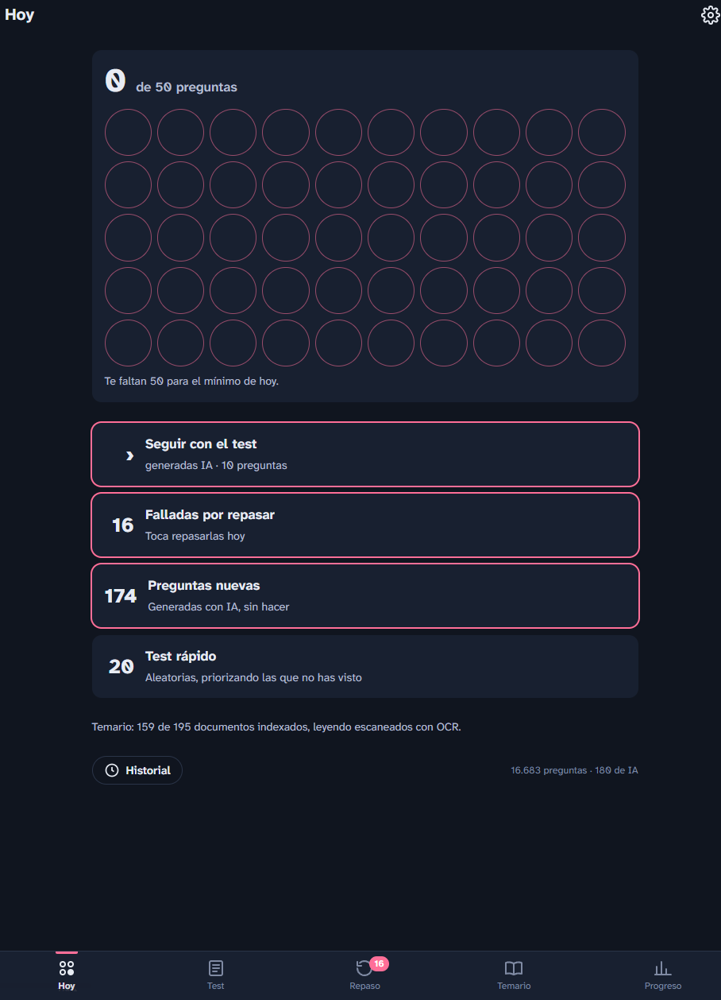
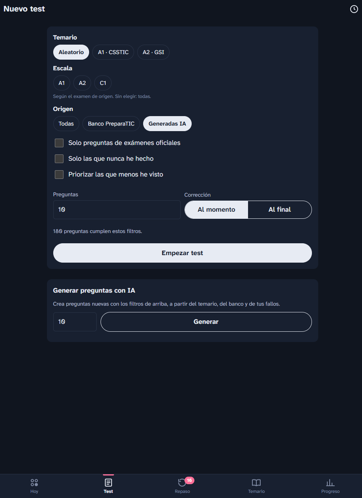
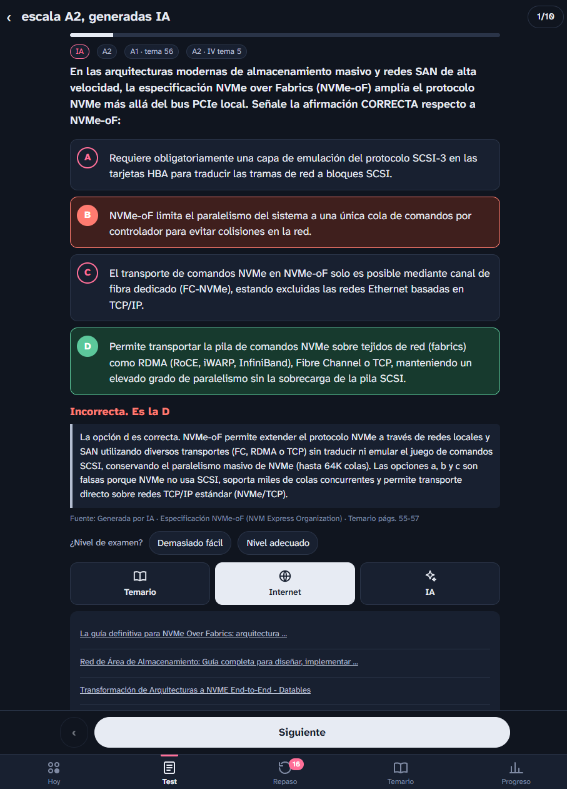
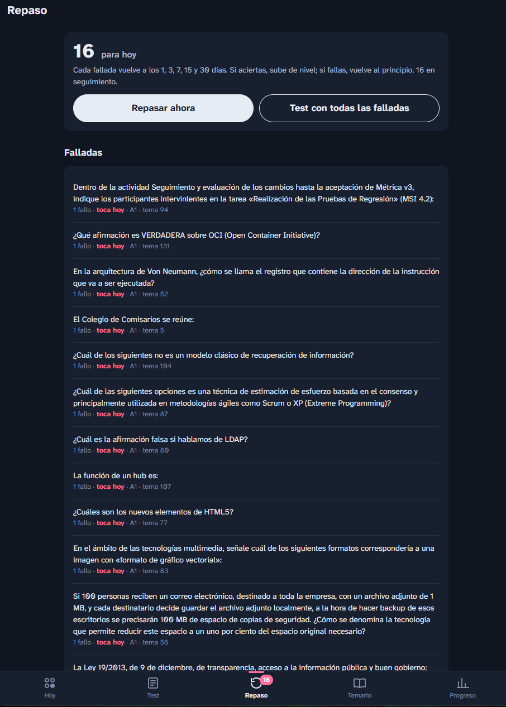

# OpoTest TIC

Plataforma de **tests de aprendizaje continuo** para las oposiciones TIC de la Administración (A1, A2 GSI y C1 TAI). Servidor en Python autoalojado en una Raspberry Pi, con web y app Android, que combina un banco de preguntas, el temario indexado y generación de preguntas con IA.

## Qué hace

- **Tests configurables** por temario, bloque, tema, escala y origen, con corrección al momento o al final y penalización por fallo como en el examen real.
- **Repaso espaciado**: cada pregunta fallada vuelve a los 1, 3, 7, 15 y 30 días, con aviso cuando hay repasos pendientes.
- **Revisión con tres fuentes** en cada pregunta: fragmentos del temario con las palabras resaltadas, resultados de búsqueda y una explicación generada por IA que valida la respuesta del banco.
- **Preguntas nuevas con IA (Gemini)** a partir del temario y de tus fallos, centradas en los temas que peor llevas. Cada pregunta generada pasa por un segundo modelo que la resuelve a ciegas y descarta las ambiguas o demasiado fáciles.
- **Dificultad adaptativa**: el nivel de las preguntas de IA sube o baja según tu rendimiento.
- **Temario buscable**: indexación de PDFs, con OCR para los escaneados, procesado en segundo plano a baja prioridad.
- **Estadísticas**: actividad diaria, temas más fallados, resultados por bloque y escala, rachas y franja horaria de mejor rendimiento.

## Capturas

<table>
  <tr>
    <td align="center"></td>
    <td align="center"></td>
    <td align="center"></td>
    <td align="center"></td>
  </tr>
  <tr>
    <td align="center">Hoy</td>
    <td align="center">Nuevo test</td>
    <td align="center">Pregunta corregida</td>
    <td align="center">Repaso espaciado</td>
  </tr>
</table>

## Arquitectura

```
 Temario (PDF) ──► OCR / extracción de texto ──┐
 Banco de preguntas ──► importador ────────────┤
                                               ▼
                         Servidor Python (Raspberry Pi)
                         ├─ API (Starlette) + SPA web
                         ├─ lógica de tests y repaso espaciado
                         ├─ generación y revisión con Gemini
                         └─ SQLite
                                   │  Tailscale
                                   ▼
                     App Android (Java): web + avisos nativos
```

## Tecnologías

- **Backend**: Python 3, Starlette, SQLite.
- **IA**: API de Gemini para generación, revisión y explicación de preguntas.
- **Procesado de documentos**: poppler y Tesseract OCR (español).
- **Frontend**: SPA en HTML, CSS y JavaScript sin frameworks.
- **App**: Android nativo en Java, con servicio de sondeo y notificaciones.
- **CI/CD**: GitHub Actions compila y publica la APK.
- **Infraestructura**: Raspberry Pi, servicios `systemd`, Tailscale.

## Estructura

```
server/
  app.py        API y rutas
  logic.py      tests, puntuación y repaso espaciado
  gemini.py     generación y revisión con IA
  ingest.py     indexación y OCR del temario
  importer.py   carga del catálogo y del banco de preguntas
  web/          interfaz web
android/        app Android
pi/, pc/        scripts de instalación
```

## Datos

El banco de preguntas de origen externo **no se incluye** en el repositorio, porque no es contenido propio. El importador lo carga si existe `server/data/preguntas_preparatic.json`; si no está, omite ese paso y el resto de la importación continúa.

## Puesta en marcha

La guía completa (instalación del servidor en la Raspberry, temario, APK) está en [INSTALACION.md](INSTALACION.md).
